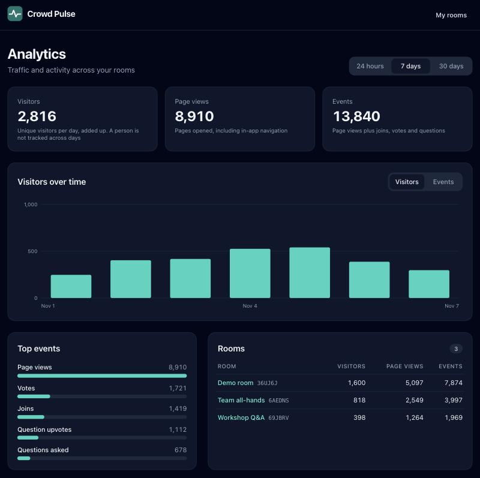
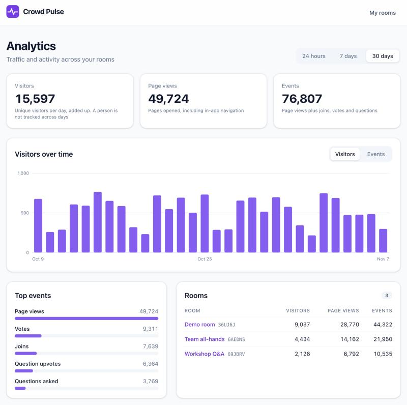
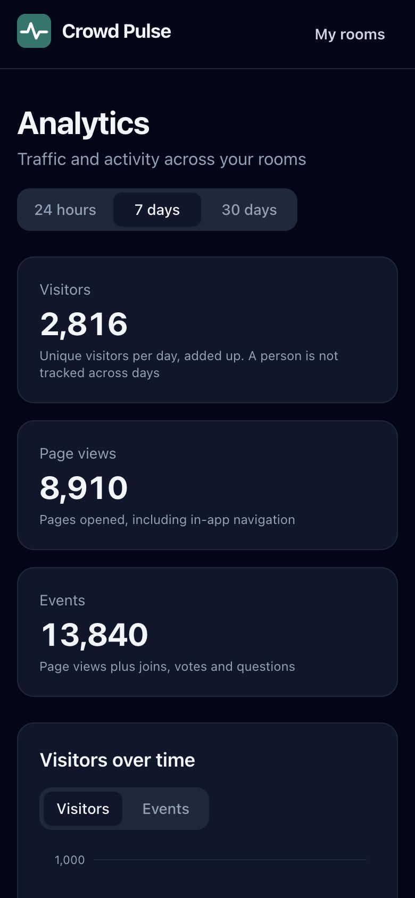
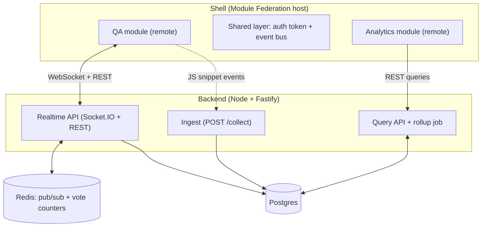

# Crowd Pulse

[](https://github.com/ebubekirylmaz/crowd-pulse/actions/workflows/ci.yml)

A live Q&A and polling platform, a lightweight privacy-friendly analytics tool, and a micro-frontend shell that ties them together as independently deployed modules.

**Live demo:** [crowd-pulse-shell.vercel.app](https://crowd-pulse-shell.vercel.app) · **Demo video:** _coming soon_ · **Architecture decisions:** [`docs/adr`](./docs/adr)

## Screenshots

The analytics dashboard, filled with about 66,000 synthetic events (see [Generating sample analytics data](#generating-sample-analytics-data)). It follows the system light or dark theme until you pick one with the toggle in the top right corner, and then remembers your choice. It works on a phone too.

| Dark, last 7 days | Light, last 30 days |
| --- | --- |
|  |  |

<p align="center">
  
</p>

---

## Status

Work in progress, built in public as a portfolio project.

| Part                     | State                                                                  |
| ------------------------ | ---------------------------------------------------------------------- |
| Live Q&A and polling     | Working end to end and deployed (Vercel for the web app, Railway for the API, Postgres and Redis) |
| Host tools               | Presenter mode, question moderation (answered state), anonymous questions |
| Demo                     | One-click throwaway demo room, no sign-up                              |
| Automated tests and CI   | 31 API integration tests, 12 snippet tests, 6 event bus tests and 4 Playwright end-to-end tests, run with typecheck and builds of all three apps on every push |
| Redis pub/sub fan-out    | Done: Socket.IO Redis adapter, tested with two API instances |
| Load test                | 5,000 connections in one room, p95 vote-to-screen under 200 ms (see below) |
| Analytics                | Snippet, ingest, partitioned storage, rollups, query API, dashboard, load tests and ADRs done |
| Micro-frontend shell     | Shell, Q&A and Analytics as three Module Federation apps working locally, with a fallback when a remote is down; deploy pipelines and e2e tests next |

## Why this project

Most portfolio apps are a single frontend talking to a single API. This project is built to show the parts of full stack work that usually only appear in real products:

- **Real-time systems:** WebSocket rooms, horizontal scaling with Redis pub/sub, reconnect and duplicate-vote handling.
- **Data pipelines:** a cookieless event collector, raw event storage, rollup tables and fast dashboard queries.
- **Frontend architecture:** two independently deployed apps composed at runtime with Module Federation, sharing auth and state.
- **Engineering practice:** measured performance numbers, architecture decision records, end-to-end tests and one-command local setup.

## Features

### Live Q&A and polling

- Host signs up, creates a room and gets a join link and QR code
- Participants join from their phone with just a display name, no account needed
- One active poll per room (enforced by a partial unique index), results update live without page refresh
- Participants submit questions (optionally anonymously) and upvote them, the most upvoted rise to the top, with a Top / Newest toggle
- Host marks questions as answered, answered questions sink and show an Answered badge
- One vote per participant per poll and one upvote per question, enforced in the database
- Host manages polls from a dashboard: create, activate, close, and watch live results
- Presenter mode for projectors: full-screen live results, big QR code and room code, top open questions
- One-click demo: creates a throwaway host with a ready room, poll and sample questions, rate limited per IP and deleted after 24 hours
- Landing page with a how-it-works section and link previews (Open Graph) for sharing

### Analytics

- Tiny JS snippet (about 1.1 KB gzipped, a 2 KB budget enforced by the build), cookieless, sends events with `sendBeacon` in batches, follows single page app navigation and skips visitors who send Do Not Track
- `POST /collect` with strict validation, a per-IP rate limit, and bot and Do Not Track filtering. The IP address is never stored: a unique visitor is a keyed hash of IP and user agent whose key rotates every day, so a person cannot be followed from one day to the next
- Raw events stored in daily range partitions of a Postgres table (30 days of retention, expired days are dropped as whole partitions), hourly and daily rollup tables for fast reads
- Query API for a host's rooms: totals, a continuous time series and top events for the last 24 hours, 7 days or 30 days
- Dashboard at `/host/analytics` with visitors, page views and events, a bar chart drawn as plain SVG (24 hours, 7 days or 30 days, visitors or events), top events, a per-room breakdown with drill-down, loading skeletons, light and dark themes, a phone friendly layout and a quiet refresh every minute. It is its own app (`apps/analytics`) that exposes one component taking a token, and the shell loads it at runtime

### Micro-frontend shell

- `apps/shell` is the host. It owns the router and the host token check, and loads the other two apps at runtime with Module Federation: `apps/qa` exposes its routes (`qa/Routes`) and `apps/analytics` exposes the dashboard (`analytics/Dashboard`)
- React, React DOM and React Router are shared singletons, so a link inside one module navigates inside the shell without a page load
- The host token is read from one storage key and handed to the analytics module as a prop, so modules do not import each other's code
- If a remote cannot be loaded, the shell keeps its header and shows an "unavailable" card with a retry (a reload), and the other module keeps working
- Modules never call each other's code. The Q&A module emits typed domain events (`poll:voted`, `question:asked` and so on) through a tiny shared bus, and a bridge in the shell forwards them to analytics ([ADR 0008](./docs/adr/0008-event-based-module-communication.md))
- Each app has its own build, and the shell finds the remotes through `REMOTE_QA_URL` and `REMOTE_ANALYTICS_URL`, so they can be deployed independently
- Design reasons and trade-offs are in [ADR 0007](./docs/adr/0007-module-federation-shell.md)

## Architecture

The diagram shows the target architecture. Today the Q&A app talks to the realtime API over REST and Socket.IO, and Postgres holds all state.



The Q&A module talks to the realtime API. The analytics snippet embedded in Q&A pages sends the same activity (joins, votes, questions) to the ingest endpoint, and the Analytics module reads aggregated results from the query API.

### How the realtime part works

- Participants get a random session token when they join, and connect to Socket.IO with it. Hosts connect with their JWT and the room code, and the server checks that the room belongs to them.
- Every socket joins a `room:<id>` channel. Votes, questions and upvotes are sent as events with an acknowledgement, and the server broadcasts the updated state to the whole room.
- The server never trusts the client for identity: room and participant ids come from the authenticated socket, not from the payload.
- Duplicate votes are rejected by a unique constraint on `(poll_id, participant_id)`, so two simultaneous requests cannot both succeed.

### API overview

| Method and path                  | Access      | Purpose                                              |
| -------------------------------- | ----------- | ---------------------------------------------------- |
| `POST /auth/register`            | public      | Create a host account                                |
| `POST /auth/login`               | public      | Get a JWT                                            |
| `GET /auth/me`                   | host        | Current host                                         |
| `POST /rooms`, `GET /rooms`      | host        | Create and list own rooms                            |
| `GET /rooms/:code`               | public      | Look up a room by its join code                      |
| `POST /rooms/:code/join`         | public      | Join as a participant, returns a session token       |
| `POST /rooms/:code/polls`        | host        | Create a poll with 2 to 10 options                   |
| `GET /rooms/:code/polls`         | host        | List polls with live results                         |
| `GET /rooms/:code/polls/active`  | public      | Active poll with vote counts                         |
| `POST /polls/:id/activate`       | host        | Activate a poll, closing the previous active one     |
| `POST /polls/:id/close`          | host        | Close a poll                                         |
| `GET /rooms/:code/questions`     | public      | Questions sorted by upvotes                          |
| `POST /questions/:id/answered`   | host        | Mark a question answered or reopen it                |
| `POST /demo`                     | public      | Create a temporary demo host, room and poll (rate limited) |
| `POST /collect`                  | public      | Analytics ingest: batch of up to 20 events, rate limited per IP, answers `204` |
| `GET /analytics/overview`        | host        | Totals, series and per-room breakdown for the host's rooms (`range=24h`, `7d` or `30d`) |
| `GET /analytics/rooms/:code`     | host        | Totals, series and top events for one room           |
| `GET /health`                    | public      | Postgres and Redis status                            |

Socket events: `vote:cast`, `question:ask` and `question:upvote` from participants; `poll:activated`, `poll:closed`, `poll:results`, `question:new` and `question:updated` from the server.

## Tech stack

| Area             | Choice                                                                                    |
| ---------------- | ----------------------------------------------------------------------------------------- |
| Monorepo         | npm workspaces + Turborepo                                                                |
| Frontend         | React, TypeScript, Vite, Tailwind CSS (Module Federation planned)                         |
| Realtime backend | Node.js, Fastify, Socket.IO, zod, argon2, JWT                                             |
| Data             | Postgres 16 with plain SQL migrations, Redis 7                                            |
| Testing          | Vitest integration tests and Playwright end-to-end tests (done); Lighthouse planned                    |
| Infra            | Docker Compose locally; Vercel or Cloudflare for frontends, Fly.io or Railway for backend |

## Repository layout

```text
.
├── apps/
│   ├── shell/          # Module Federation host: router, auth check, loads the two remotes
│   ├── qa/             # Remote: live Q&A and polling UI (also runs standalone)
│   └── analytics/      # Remote: analytics dashboard
├── packages/
│   ├── ui/             # Shared components, icons and the Tailwind theme
│   ├── events/         # Typed event bus the modules use to talk, plus the analytics bridge
│   └── snippet/        # Cookieless analytics JS snippet, built with esbuild, size budget enforced
├── services/
│   └── api/
│       ├── src/        # Fastify app: routes, realtime, db access
│       ├── migrations/ # Plain SQL migrations, applied in order
│       └── test/       # Vitest integration tests
├── docker-compose.yml  # Postgres and Redis
└── turbo.json
```

## Getting started

**Prerequisites:** Node.js 20+, npm, Docker

1. Install dependencies:

```bash
npm install
```

2. Create your environment file and fill in the values (see the table below):

```bash
cp .env.example .env
```

3. Start Postgres and Redis:

```bash
docker compose up -d
```

4. Apply the database migrations:

```bash
npm run migrate -w services/api
```

5. Start the API and the web app together:

```bash
npm run dev
```

The API runs on `http://localhost:3000`. Open the shell on `http://localhost:5175`, which loads the Q&A app (served on 5173) and the analytics dashboard (served on 5174) at runtime. The Q&A app also works on its own at `http://localhost:5173`, without the analytics page.

**Try it:** open `/host/login`, sign up, create a room and open it. Scan the QR code (or open the join link) on another device or in a private window, join with a name, and vote on a poll the host activates.

### Running the tests

With Docker running:

```bash
npm test
```

The tests use a separate `crowd_pulse_test` database that is created and migrated automatically, and they refuse to run against any database whose name does not end in `_test`.

The same checks run in GitHub Actions on every push (`.github/workflows/ci.yml`) against Postgres and Redis service containers: the API typecheck and tests, production builds of the shell and both modules, and the Playwright end-to-end tests.

End-to-end tests start the API and serve the three built apps on separate ports, which is the same cross-origin setup as in production, then drive a real browser:

```bash
npx playwright install chromium
npm run build:apps -w @crowd-pulse/e2e
npm run e2e -w @crowd-pulse/e2e
```

They need Postgres and Redis (`docker compose up -d`) and the same `DATABASE_URL`, `REDIS_URL` and `JWT_SECRET` as the API, so point `DATABASE_URL` at a scratch database. Set `E2E_CHANNEL=chrome` to use an installed Chrome instead of downloading Chromium.

### Running the load test

Start the API (for example `npm run dev`), then in another terminal:

```bash
npm run loadtest -w services/api -- --url http://localhost:3000 --participants 1000 --window 3000
```

The script creates a throwaway demo room, joins the requested number of participants over REST, connects them over WebSocket, makes each of them vote once at a random moment inside the window (in milliseconds), and reports connection time, vote acknowledgement latency, the time until the host sees each vote, and whether the accepted, broadcast and stored totals match. It needs the demo endpoint, so it is limited by `DEMO_LIMIT_PER_HOUR` per IP.

### Generating sample analytics data

To see the dashboard filled in, or to test queries against a realistic volume, seed synthetic events for existing rooms:

```bash
npm run seed:analytics -w services/api -- --rooms ABC123,DEF456 --days 30 --events 60000
```

Each synthetic visitor has a home room and always starts with a page view, events follow a daily curve with quieter weekends, and the hourly and daily rollups are refreshed at the end. It writes to whatever `DATABASE_URL` points at and prints the database name first. Add `--reset` to empty the analytics tables before seeding, and run it against a scratch database when in doubt.

### Measuring ingest and dashboard queries

With the API running against a scratch database, the ingest test sends batches to `/collect` from many different client addresses for a fixed time, then checks how one address behaves against the rate limit:

```bash
npm run loadtest:ingest -w services/api -- --url http://localhost:3000 --duration 10 --concurrency 64 --batch 5
```

After seeding data, the dashboard benchmark calls the analytics endpoints in process as the host that owns the seeded rooms and prints p50, p95 and max per endpoint, next to the same questions asked of the raw events table:

```bash
npm run bench:dashboard -w services/api
```

Both ran on one laptop with the load generator, the API and the databases sharing the CPU, and the benchmark skips network time, so read the results as a floor. The reasoning is in [ADR 0005](./docs/adr/0005-raw-events-plus-rollups.md).

### Using the analytics snippet

The web app loads the snippet from its own `/cp.js`, and any other site can embed it with one tag:

```html
<script async src="https://your-site.example/cp.js" data-endpoint="https://your-api.example/collect" data-room-regex="^/room/([A-Za-z0-9]{4,12})"></script>
```

It records a page view on load and on every client-side navigation, and exposes `window.cp.track(name, props)` for custom events such as `vote`. `data-room-regex` is optional: its first capture group becomes the room code the event is attributed to. The snippet does nothing when the browser sends Do Not Track or Global Privacy Control, it never reads or writes cookies or storage, and the build prints its size and fails above 2 KB gzipped.

### Environment variables

| Variable                                      | Description                                                              |
| --------------------------------------------- | ------------------------------------------------------------------------ |
| `POSTGRES_USER`, `POSTGRES_PASSWORD`, `POSTGRES_DB` | Credentials used by Docker Compose to create the database          |
| `DATABASE_URL`                                | Postgres connection string                                               |
| `REDIS_URL`                                   | Redis connection string                                                  |
| `JWT_SECRET`                                  | Secret used to sign host auth tokens (use a long random value)           |
| `CORS_ORIGIN`                                 | Optional. Allowed web origin, defaults to `http://localhost:5173`        |
| `PORT`                                        | Optional. API port, defaults to `3000`                                   |
| `VITE_API_URL`                                | Optional, web app. API base URL, defaults to `http://localhost:3000`     |
| `VITE_SITE_URL`                               | Web app. Public site address used in link previews, set in `apps/qa/.env.production` |
| `DEMO_LIMIT_PER_HOUR`                         | Optional. Demo rooms allowed per IP per hour, defaults to `5`            |
| `ANALYTICS_SECRET`                            | Optional. Key behind the daily visitor hash, defaults to a value derived from `JWT_SECRET` |
| `COLLECT_LIMIT_PER_MINUTE`                    | Optional. Analytics requests allowed per IP per minute, defaults to `120` |

## Performance and measurements

Numbers come from real test runs, not estimates. The realtime numbers were measured with `npm run loadtest -w services/api` against a single API instance. The API, Postgres, Redis and the load generator all ran on one laptop (Apple M2, 8 cores, Node 24), and the load generator is a single Node process sharing that CPU, so treat these as a conservative floor for the server and not as a production benchmark.

| Metric                                         | Target     | Result |
| ---------------------------------------------- | ---------- | ------ |
| Concurrent WebSocket connections in one room   | n/a        | 5,000 connected, 0 failures |
| Vote to host-screen latency (p95)              | under 1 s  | 158 ms (1,000 voters in 3 s), 182 ms (5,000 voters in 5 s) |
| Vote acknowledgement latency (p95)             | n/a        | 17 ms (1,000 voters in 3 s), 59 ms (5,000 voters in 5 s) |
| Analytics snippet size (gzipped)               | under 2 KB | 1,086 bytes (the build fails above 2,048) |
| Ingest throughput (events/sec)                 | n/a        | 31,848 events/s (6,370 requests/s, 5 events per request, 64 workers), p95 17.6 ms, 0 events lost |
| Dashboard query time (p95) over synthetic data | under 100 ms | 1.7 ms for 7 and 30 days, 33 ms for one room over 24 hours, 111 ms for the 24 hour overview (852,083 events) |
| Shell + remotes first load (home page)         | n/a        | 185 KB transferred in 38 requests on the live site, shell, Q&A module and shared React included |
| Lighthouse, live home page                     | 90+ each   | Desktop 99 / 100 / 100 / 100, mobile 84-91 / 100 / 100 / 100 over three runs (performance, accessibility, best practices, SEO); mobile LCP 3.0-3.5 s, no blocking time, no layout shift |

The first run, before result broadcasts were throttled, showed a p95 vote-to-screen time of 901 ms with 1,000 voters and 1,980 ms when they all voted within half a second. Every vote was broadcast to the whole room, so the work grew with the square of the audience. Throttling the broadcasts brought those cases down to 158 ms and 151 ms, with all totals still matching exactly. The investigation and the trade-off are written up in [ADR 0004](./docs/adr/0004-throttle-result-broadcasts.md).

The first Lighthouse run found an invalid `robots.txt` (the single page app rewrite answered with HTML) and scored SEO 91, fixed by serving a real file, now 100. It also showed that the mobile page load is a chain: the shell starts, then fetches the Q&A module's entry, then its route code. Preconnecting to the module and API hosts and preloading the module entry did not move the mobile score outside its run-to-run noise (88 before, 84 to 91 after), so the remaining time is the cost of loading two separately deployed modules over a throttled connection. That is the trade-off ADR 0007 accepts for independent deploys.

## Architecture decision records

Written so far, in [`docs/adr`](./docs/adr):

1. [Socket.IO with a Redis adapter for realtime fan-out](./docs/adr/0001-socketio-with-redis-adapter.md)
2. [One vote per participant, enforced by the database](./docs/adr/0002-one-vote-enforced-by-the-database.md)
3. [Plain SQL migrations applied at startup under an advisory lock](./docs/adr/0003-sql-migrations-at-startup.md)
4. [Throttle poll result broadcasts to one per 150 ms per poll](./docs/adr/0004-throttle-result-broadcasts.md)
5. [Keep raw events for 30 days and serve the dashboard from rollups](./docs/adr/0005-raw-events-plus-rollups.md)
6. [Count visitors without cookies, with a hash that rotates every day](./docs/adr/0006-cookieless-visitor-counting.md)
7. [Compose the app with Module Federation, three apps and a shared UI package](./docs/adr/0007-module-federation-shell.md)
8. [Modules talk through typed events, not through each other's code or a global store](./docs/adr/0008-event-based-module-communication.md)

Planned, written as the decisions are made:

- Shared state between remotes: event-based instead of a global store
- Host token storage: `localStorage` for v1 versus an `httpOnly` cookie

## Roadmap

**Week 1: Live Q&A and polling**

- [x] Monorepo, API skeleton, Postgres schema, Docker Compose
- [x] WebSocket rooms, vote and question events
- [x] Host view and participant view (mobile first)
- [x] Live results, duplicate-vote prevention, API integration tests
- [x] Reconnect polish: a participant's own vote and upvotes are restored after a refresh (stored per browser)
- [x] First deployment with a public demo room
- [x] Presenter mode, anonymous questions, answered state, landing page, link previews
- [x] GitHub Actions CI: typecheck, API tests against Postgres and Redis, web build
- [x] Redis pub/sub adapter for multi-instance fan-out, covered by two-instance tests
- [x] Realtime load test and measurements, with ADRs for the decisions behind them

**Week 2: Analytics**

- [x] JS snippet and ingest endpoint with rate limiting
- [x] Time-partitioned raw events and rollup jobs
- [x] Query API
- [x] Dashboard UI
- [x] Load tests and first measurements

**Week 3: Micro-frontend shell and polish**

- [x] Shell app with Module Federation, shared token, remote failure fallback
- [x] Event-based communication between modules, with a typed bus and an ADR
- [ ] Independent deploy pipelines per module
- [x] Playwright e2e tests (live poll through the shell, analytics module, remote failure fallback), run in CI
- [x] Lighthouse run on the live site
- [ ] Final README pass, ADRs, demo video

## Scope

**In scope for v1:** one active poll per room, questions with upvotes, basic analytics (visitors, events, time series, per-room breakdown), host auth, anonymous participants.

**Out of scope for v1:** payments, multi-language UI, native mobile apps, moderation workflows, advanced analytics (funnels, segments).

## License

MIT (to be confirmed)
