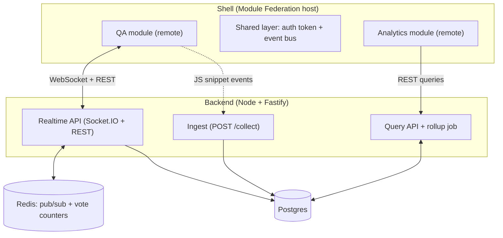

# Event Platform

> Working title. A live Q&A and polling platform, a lightweight privacy-friendly analytics tool, and a micro-frontend shell that ties them together as independently deployed modules.

**Live demo:** _coming soon_ · **Demo video:** _coming soon_ · **Architecture decisions:** [`docs/adr`](./docs/adr)

---

## Why this project

Most portfolio apps are a single frontend talking to a single API. This project is built to show the parts of full stack work that usually only appear in real products:

- **Real-time systems:** WebSocket rooms, horizontal scaling with Redis pub/sub, reconnect and duplicate-vote handling.
- **Data pipelines:** a cookieless event collector, raw event storage, rollup tables and fast dashboard queries.
- **Frontend architecture:** two independently deployed apps composed at runtime with Module Federation, sharing auth and state.
- **Engineering practice:** measured performance numbers, architecture decision records, end-to-end tests and one-command local setup.

## Features

### Live Q&A and polling
- Host creates a room and gets a join link and QR code
- Participants join from their phone with just a display name, no account needed
- One active poll per room, results update live without page refresh
- Participants submit questions and upvote them, the most upvoted rise to the top
- Reconnect handling and one vote per participant session

### Analytics
- Tiny JS snippet (target: under 2 KB), cookieless, sends events with `sendBeacon` in batches
- Ingest endpoint with validation and rate limiting
- Raw events stored in a time-partitioned table, hourly and daily rollup tables for fast reads
- Dashboard with visitors, event counts, time series and per-room breakdown

### Micro-frontend shell
- Host app composes the Q&A and Analytics modules at runtime (Module Federation)
- Shared auth token and an event-based shared state between modules
- Each module has its own build and deploy pipeline
- Fallback UI when a remote fails to load

## Architecture



The Q&A module talks to the realtime API. The analytics snippet embedded in Q&A pages sends the same activity (joins, votes, questions) to the ingest endpoint, and the Analytics module reads aggregated results from the query API.

## Tech stack

| Area | Choice |
| --- | --- |
| Monorepo | pnpm workspaces + Turborepo |
| Frontend | React, TypeScript, Vite, Module Federation |
| Realtime backend | Node.js, Fastify, Socket.IO |
| Data | Postgres (events, rollups, rooms, votes), Redis (pub/sub, counters) |
| Testing | Playwright (e2e), k6 (load tests), Lighthouse (performance) |
| Infra | Docker Compose locally; Vercel or Cloudflare for frontends, Fly.io or Railway for backend |

## Repository layout

> Planned structure, will be adjusted as the project grows.

```text
.
├── apps/
│   ├── shell/          # Module Federation host (auth, navigation, shared state)
│   ├── qa/             # Remote: live Q&A and polling UI
│   └── analytics/      # Remote: analytics dashboard UI
├── packages/
│   ├── snippet/        # Cookieless analytics JS snippet
│   ├── shared/         # Shared types, event contracts, UI primitives
│   └── config/         # Shared TS, ESLint and build config
├── services/
│   └── api/            # Fastify app: realtime, ingest, query, rollup jobs
├── docs/
│   └── adr/            # Architecture decision records
├── e2e/                # Playwright tests
├── load/               # k6 scripts
└── docker-compose.yml
```

## Getting started

**Prerequisites:** Node.js 20+, pnpm, Docker

```bash
# 1. install dependencies
pnpm install

# 2. start Postgres, Redis and the API
docker compose up -d

# 3. run all frontends in dev mode
pnpm dev
```

Then open the shell app and create a room from the host view. Exact ports and environment variables will be documented here once the first version runs.

### Environment variables

| Variable | Description |
| --- | --- |
| `DATABASE_URL` | Postgres connection string |
| `REDIS_URL` | Redis connection string |
| `JWT_SECRET` | Secret used to sign host auth tokens |
| `ANALYTICS_SALT_ROTATION` | Rotation period for the daily salt used in cookieless visitor hashing |

## Performance and measurements

Numbers will be filled in from real test runs, not estimates.

| Metric | Target | Result |
| --- | --- | --- |
| Concurrent WebSocket connections in one room | _TBD_ | _TBD_ |
| Vote to host-screen latency (p95) | under 1 s | _TBD_ |
| Analytics snippet size (gzipped) | under 2 KB | _TBD_ |
| Ingest throughput (events/sec) | _TBD_ | _TBD_ |
| Dashboard query time (p95) over synthetic data | _TBD_ | _TBD_ |
| Shell + remotes bundle sizes | _TBD_ | _TBD_ |

## Architecture decision records

Planned ADRs, written as the decisions are made:

1. Why Socket.IO and Redis pub/sub for realtime fan-out
2. Vote counting: Redis counters with periodic Postgres persistence
3. Anonymous participant identity and duplicate-vote prevention
4. Raw events plus rollup tables vs. live aggregation, and when ClickHouse would make sense
5. Cookieless unique visitor counting with a rotating salt
6. Why Module Federation (and why not iframes or a single app)
7. Shared state between remotes: event-based instead of a global store

## Roadmap

**Week 1: Live Q&A and polling**
- [ ] Monorepo, API skeleton, Postgres schema, Docker Compose
- [ ] WebSocket rooms, Redis pub/sub, vote and question events
- [ ] Host view and participant view (mobile first)
- [ ] Live results chart, reconnect and duplicate-vote handling
- [ ] First deployment with a public demo room

**Week 2: Analytics**
- [ ] JS snippet and ingest endpoint with rate limiting
- [ ] Time-partitioned raw events and rollup jobs
- [ ] Query API and dashboard UI
- [ ] Load tests and first measurements

**Week 3: Micro-frontend shell and polish**
- [ ] Shell app with Module Federation, shared auth and state
- [ ] Independent CI/CD per module, remote failure fallback
- [ ] Playwright e2e tests, Lighthouse and bundle size checks
- [ ] Final README pass, ADRs, demo video

## Scope

**In scope for v1:** one active poll per room, questions with upvotes, basic analytics (visitors, events, time series, per-room breakdown), host auth, anonymous participants.

**Out of scope for v1:** payments, multi-language UI, native mobile apps, moderation workflows, advanced analytics (funnels, segments).

## License

MIT (to be confirmed)
