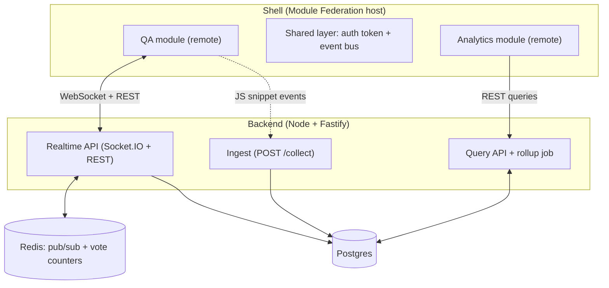

# Crowd Pulse

A live Q&A and polling platform, a lightweight privacy-friendly analytics tool, and a micro-frontend shell that ties them together as independently deployed modules.

**Live demo:** _coming soon_ · **Demo video:** _coming soon_ · **Architecture decisions:** _coming soon_

---

## Status

Work in progress, built in public as a portfolio project.

| Part                     | State                                                    |
| ------------------------ | -------------------------------------------------------- |
| Live Q&A and polling     | Working end to end locally (host and participant flows)  |
| API integration tests    | 8 tests covering auth, ownership, voting and questions   |
| Redis pub/sub fan-out    | Planned (Redis is currently used for the health check)   |
| Deployment and demo room | Planned                                                  |
| Analytics                | Planned                                                  |
| Micro-frontend shell     | Planned                                                  |

## Why this project

Most portfolio apps are a single frontend talking to a single API. This project is built to show the parts of full stack work that usually only appear in real products:

- **Real-time systems:** WebSocket rooms, horizontal scaling with Redis pub/sub, reconnect and duplicate-vote handling.
- **Data pipelines:** a cookieless event collector, raw event storage, rollup tables and fast dashboard queries.
- **Frontend architecture:** two independently deployed apps composed at runtime with Module Federation, sharing auth and state.
- **Engineering practice:** measured performance numbers, architecture decision records, end-to-end tests and one-command local setup.

## Features

### Live Q&A and polling

- Host signs up, creates a room and gets a join link and QR code
- Participants join from their phone with just a display name, no account needed
- One active poll per room (enforced by a partial unique index), results update live without page refresh
- Participants submit questions and upvote them, the most upvoted rise to the top
- One vote per participant per poll and one upvote per question, enforced in the database
- Host manages polls from a dashboard: create, activate, close, and watch live results

### Analytics _(planned)_

- Tiny JS snippet (target: under 2 KB), cookieless, sends events with `sendBeacon` in batches
- Ingest endpoint with validation and rate limiting
- Raw events stored in a time-partitioned table, hourly and daily rollup tables for fast reads
- Dashboard with visitors, event counts, time series and per-room breakdown

### Micro-frontend shell _(planned)_

- Host app composes the Q&A and Analytics modules at runtime (Module Federation)
- Shared auth token and an event-based shared state between modules
- Each module has its own build and deploy pipeline
- Fallback UI when a remote fails to load

## Architecture

The diagram shows the target architecture. Today the Q&A app talks to the realtime API over REST and Socket.IO, and Postgres holds all state.



The Q&A module talks to the realtime API. The analytics snippet embedded in Q&A pages sends the same activity (joins, votes, questions) to the ingest endpoint, and the Analytics module reads aggregated results from the query API.

### How the realtime part works

- Participants get a random session token when they join, and connect to Socket.IO with it. Hosts connect with their JWT and the room code, and the server checks that the room belongs to them.
- Every socket joins a `room:<id>` channel. Votes, questions and upvotes are sent as events with an acknowledgement, and the server broadcasts the updated state to the whole room.
- The server never trusts the client for identity: room and participant ids come from the authenticated socket, not from the payload.
- Duplicate votes are rejected by a unique constraint on `(poll_id, participant_id)`, so two simultaneous requests cannot both succeed.

### API overview

| Method and path                  | Access      | Purpose                                              |
| -------------------------------- | ----------- | ---------------------------------------------------- |
| `POST /auth/register`            | public      | Create a host account                                |
| `POST /auth/login`               | public      | Get a JWT                                            |
| `GET /auth/me`                   | host        | Current host                                         |
| `POST /rooms`, `GET /rooms`      | host        | Create and list own rooms                            |
| `GET /rooms/:code`               | public      | Look up a room by its join code                      |
| `POST /rooms/:code/join`         | public      | Join as a participant, returns a session token       |
| `POST /rooms/:code/polls`        | host        | Create a poll with 2 to 10 options                   |
| `GET /rooms/:code/polls`         | host        | List polls with live results                         |
| `GET /rooms/:code/polls/active`  | public      | Active poll with vote counts                         |
| `POST /polls/:id/activate`       | host        | Activate a poll, closing the previous active one     |
| `POST /polls/:id/close`          | host        | Close a poll                                         |
| `GET /rooms/:code/questions`     | public      | Questions sorted by upvotes                          |
| `GET /health`                    | public      | Postgres and Redis status                            |

Socket events: `vote:cast`, `question:ask` and `question:upvote` from participants; `poll:activated`, `poll:closed`, `poll:results`, `question:new` and `question:updated` from the server.

## Tech stack

| Area             | Choice                                                                                    |
| ---------------- | ----------------------------------------------------------------------------------------- |
| Monorepo         | npm workspaces + Turborepo                                                                |
| Frontend         | React, TypeScript, Vite, Tailwind CSS (Module Federation planned)                         |
| Realtime backend | Node.js, Fastify, Socket.IO, zod, argon2, JWT                                             |
| Data             | Postgres 16 with plain SQL migrations, Redis 7                                            |
| Testing          | Vitest integration tests (done); Playwright, k6 and Lighthouse planned                    |
| Infra            | Docker Compose locally; Vercel or Cloudflare for frontends, Fly.io or Railway for backend |

## Repository layout

```text
.
├── apps/
│   ├── qa/             # Live Q&A and polling UI (participant and host screens)
│   ├── shell/          # Planned: Module Federation host
│   └── analytics/      # Planned: analytics dashboard UI
├── packages/
│   ├── snippet/        # Planned: cookieless analytics JS snippet
│   └── shared/         # Planned: shared types and event contracts
├── services/
│   └── api/
│       ├── src/        # Fastify app: routes, realtime, db access
│       ├── migrations/ # Plain SQL migrations, applied in order
│       └── test/       # Vitest integration tests
├── docker-compose.yml  # Postgres and Redis
└── turbo.json
```

## Getting started

**Prerequisites:** Node.js 20+, npm, Docker

1. Install dependencies:

```bash
npm install
```

2. Create your environment file and fill in the values (see the table below):

```bash
cp .env.example .env
```

3. Start Postgres and Redis:

```bash
docker compose up -d
```

4. Apply the database migrations:

```bash
npm run migrate -w services/api
```

5. Start the API and the web app together:

```bash
npm run dev
```

The API runs on `http://localhost:3000` and the web app on `http://localhost:5173`.

**Try it:** open `/host/login`, sign up, create a room and open it. Scan the QR code (or open the join link) on another device or in a private window, join with a name, and vote on a poll the host activates.

### Running the tests

With Docker running:

```bash
npm test
```

The tests use a separate `crowd_pulse_test` database that is created and migrated automatically, and they refuse to run against any database whose name does not end in `_test`.

### Environment variables

| Variable                                      | Description                                                              |
| --------------------------------------------- | ------------------------------------------------------------------------ |
| `POSTGRES_USER`, `POSTGRES_PASSWORD`, `POSTGRES_DB` | Credentials used by Docker Compose to create the database          |
| `DATABASE_URL`                                | Postgres connection string                                               |
| `REDIS_URL`                                   | Redis connection string                                                  |
| `JWT_SECRET`                                  | Secret used to sign host auth tokens (use a long random value)           |
| `CORS_ORIGIN`                                 | Optional. Allowed web origin, defaults to `http://localhost:5173`        |
| `PORT`                                        | Optional. API port, defaults to `3000`                                   |
| `VITE_API_URL`                                | Optional, web app. API base URL, defaults to `http://localhost:3000`     |
| `ANALYTICS_SALT_ROTATION`                     | Planned: rotation period for the salt used in cookieless visitor hashing |

## Performance and measurements

Numbers will be filled in from real test runs, not estimates.

| Metric                                         | Target     | Result |
| ---------------------------------------------- | ---------- | ------ |
| Concurrent WebSocket connections in one room   | _TBD_      | _TBD_  |
| Vote to host-screen latency (p95)              | under 1 s  | _TBD_  |
| Analytics snippet size (gzipped)               | under 2 KB | _TBD_  |
| Ingest throughput (events/sec)                 | _TBD_      | _TBD_  |
| Dashboard query time (p95) over synthetic data | _TBD_      | _TBD_  |
| Shell + remotes bundle sizes                   | _TBD_      | _TBD_  |

## Architecture decision records

Planned ADRs, written as the decisions are made:

1. Why Socket.IO and Redis pub/sub for realtime fan-out
2. Vote counting: Redis counters with periodic Postgres persistence
3. Anonymous participant identity and duplicate-vote prevention
4. Raw events plus rollup tables vs. live aggregation, and when ClickHouse would make sense
5. Cookieless unique visitor counting with a rotating salt
6. Why Module Federation (and why not iframes or a single app)
7. Shared state between remotes: event-based instead of a global store

Decisions already visible in the code and still to be written up: plain SQL migrations instead of an ORM, database constraints (not application checks) for the one-vote and one-active-poll rules, and storing the host JWT in `localStorage` for v1 versus an `httpOnly` cookie.

## Roadmap

**Week 1: Live Q&A and polling**

- [x] Monorepo, API skeleton, Postgres schema, Docker Compose
- [x] WebSocket rooms, vote and question events
- [x] Host view and participant view (mobile first)
- [x] Live results, duplicate-vote prevention, API integration tests
- [ ] Redis pub/sub adapter for multi-instance fan-out
- [ ] Reconnect polish: restore a participant's own vote and upvote state after a refresh
- [ ] First deployment with a public demo room

**Week 2: Analytics**

- [ ] JS snippet and ingest endpoint with rate limiting
- [ ] Time-partitioned raw events and rollup jobs
- [ ] Query API and dashboard UI
- [ ] Load tests and first measurements

**Week 3: Micro-frontend shell and polish**

- [ ] Shell app with Module Federation, shared auth and state
- [ ] Independent CI/CD per module, remote failure fallback
- [ ] Playwright e2e tests, Lighthouse and bundle size checks
- [ ] Final README pass, ADRs, demo video

## Scope

**In scope for v1:** one active poll per room, questions with upvotes, basic analytics (visitors, events, time series, per-room breakdown), host auth, anonymous participants.

**Out of scope for v1:** payments, multi-language UI, native mobile apps, moderation workflows, advanced analytics (funnels, segments).

## License

MIT (to be confirmed)
